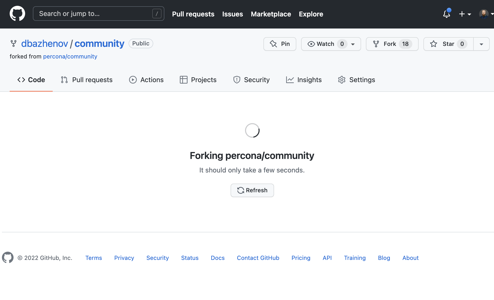
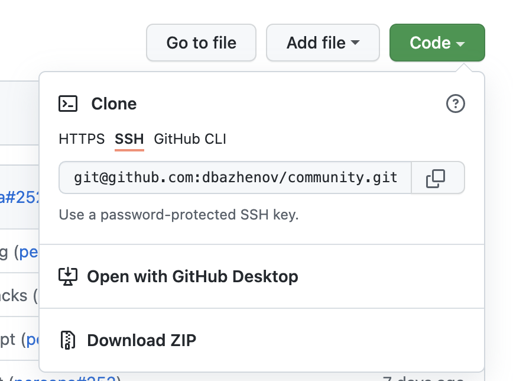
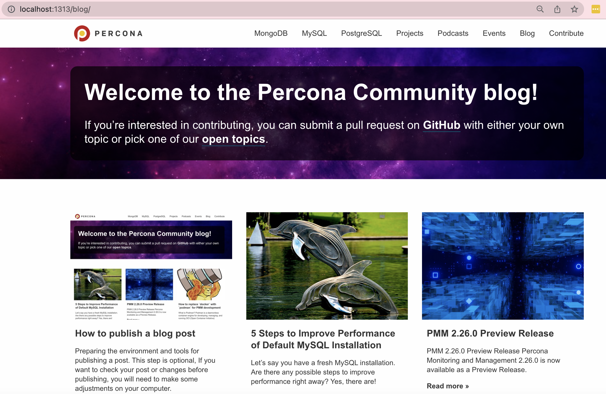
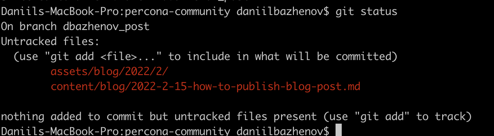
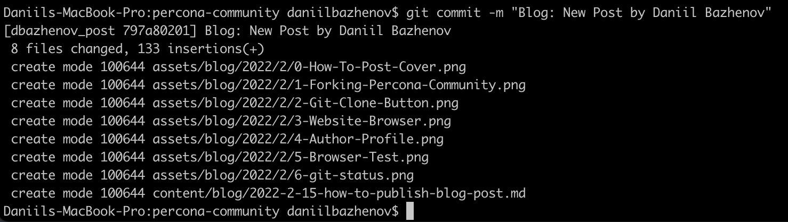
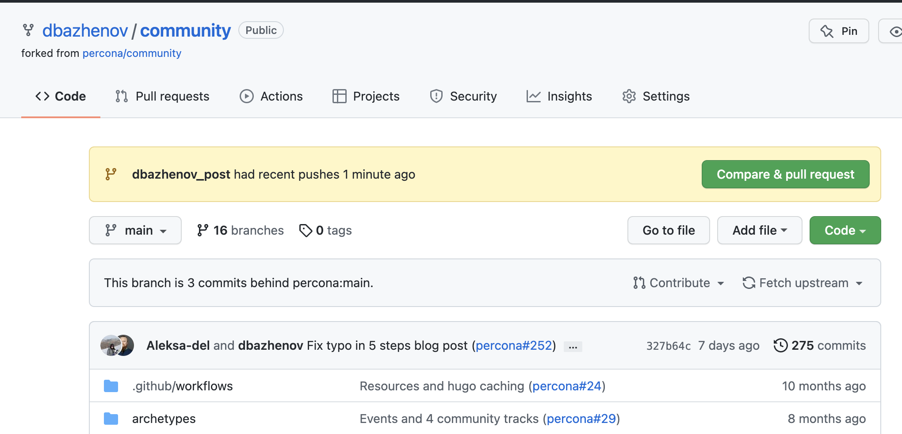
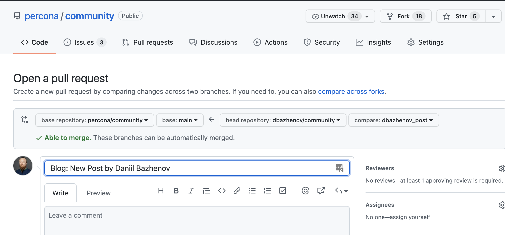
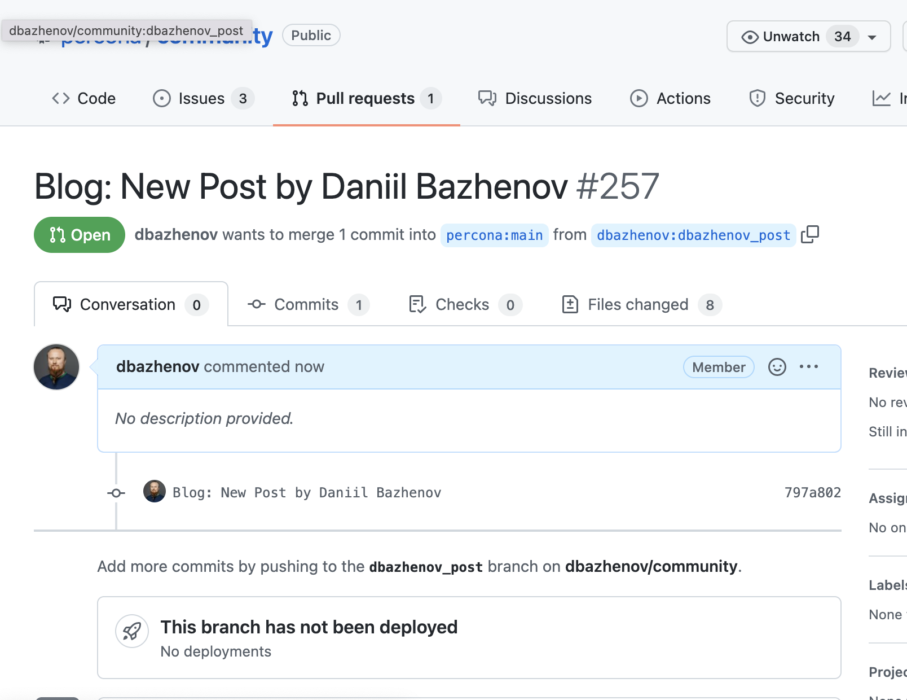

If you write technical content or just want to become an author, this blog is open to you! We accept any technical articles about databases and open source technologies. Also, we have no requirements for the uniqueness of the article. If your post is published on another resource, you can duplicate it here and get more attention.

In this post, I will explain step by step how to publish a post in our Community Blog. Following this guide step-by-step, everyone, even a non-technical person, will be able to publish the post. But if you face any issue on your way, just contact us at [contact us](#assistance-and-support). Percona Community Team will be happy to help you! 

## Preparing the Environment and Tools.

This step is optional. It will allow you to check your post before publishing. 

We use the Hugo website engine. It turns Markdown pages into HTML very quickly and easily. We also use GitHub and GitHub Pages for free website hosting. So, learn how to use the Hugo engine by following the steps below.

**Quick Steps**

I will briefly describe the steps for the professionals:
- Fork our repository ["percona/community"](https://github.com/percona/community/). Percona employees with write access can skip the fork and push a branch to `percona/community` directly.
- Make a Git Clone fork on your computer
- Install [Hugo engine](https://gohugo.io/getting-started/installing/)
- Run the Hugo server in the source code folder of the site with the command `hugo server -D` and open a local copy of the site in your browser at `localhost:1313`
- That's it, you can change the texts and see the result immediately.
- Move on to the next step "How to add a post".

**Detailed Instructions**

Now let's discuss these steps in detail.

1. You need to make a fork of our ["percona/community"](https://github.com/percona/community/) repository with the source code of the site. Just open our repository and click the "Fork" button and follow the suggested steps. As a result, you will have a copy of the repository. 



2. Git Clone your fork to your computer. Click Code to get the address to clone the repository. You can learn how to install and work with Git from the cool resource ["Git How To"](https://githowto.com/)



Open the console on your computer and type the command:

`git clone git@github.com:dbazhenov/community.git percona-community` 

It is important to clone your fork and not the main repository. You will probably need to install Git on your computer if you didn't do it before.

When cloned, all of the Git repository code will be downloaded to your computer and you will be able to modify it and run it locally.

You will see in the console:
```
Daniils-MacBook-Pro:Sites daniilbazhenov$ git clone git@github.com:dbazhenov/community.git percona-community
Cloning into 'percona-community'...
remote: Enumerating objects: 67797, done.
remote: Counting objects: 100% (5879/5879), done.
remote: Compressing objects: 100% (1346/1346), done.
remote: Total 67797 (delta 3005), reused 5847 (delta 2988), pack-reused 61918
Receiving objects: 100% (67797/67797), 399.02 MiB | 843.00 KiB/s, done.
Resolving deltas: 100% (33607/33607), done.
Updating files: 100% (1387/1387), done.
```

3. Install the Hugo website engine: [Install Hugo](https://gohugo.io/getting-started/installing/). The installation is not difficult. Follow the steps for your operating system and watch the official installation video. Hugo is a lightweight static website generator, it is free and open source software. You do not need to install a web server, programming language, or database. 

4. Open the directory with the site code in the console, in my case it is: `cd percona-community`

5. Launch the Hugo server with the command 'hugo server -D'. When you start the server, the Hugo engine scans the structure of the project, generates the site on the fly and makes it available in the browser. You will see the URL as a result in the console.

```
Daniils-MacBook-Pro:percona-community daniilbazhenov$ hugo server -D
Start building sites …

                   |  EN
-------------------+-------
  Pages            | 1107
  Paginator pages  |   23
  Non-page files   |    0
  Static files     |    2
  Processed images | 1316
  Aliases          |   64
  Sitemaps         |    1
  Cleaned          |    0

Built in 99883 ms
Watching for changes in /percona-community/{archetypes,assets,content,layouts,static}
Watching for config changes in /percona-community/config.yaml
Environment: "development"
Serving pages from memory
Running in Fast Render Mode. For full rebuilds on change: hugo server --disableFastRender
Web Server is available at http://localhost:1313/ (bind address 127.0.0.1)
Press Ctrl+C to stop
```

6. Launch the website in your browser with the port indiicated in the console, for example  `http://localhost:1313/`. When you are done with the your post, you can stop the server using the buttons indicated in the console (Ctrl+C).

Now you can edit the site, add new posts and immediately see the result in your browser.



## How to Publish a Post

I hope you have successfully made a fork and clone of the repository. Let's start publishing your post.

Our website works with text and posts marked up in [Markdown](https://www.markdownguide.org/basic-syntax/) syntax. You will probably need to edit the text a bit when you publish it.

**Quick Steps**

1. Create a separate branch for your changes.
2. Add your author card: `content/contributors/<your_name>.md`.
3. Add your photo to the folder `assets/contributors`.
4. Add your post images to `assets/blog/<YYYY>/<MM>/`.
5. Add your post in Markdown to `content/blog/<YYYY>/`.

**Detailed Instructions**

1. Open the folder with the project source code in the console. 

2. Create a separate git branch for your post.

`git checkout -b dbazhenov_post` 

3. Create a contributor card in the `content/contributors/` folder.  
   It is one file named after you, lowercase with underscores: `content/contributors/jane_doe.md`.  
   Start from the template with `hugo new contributors/jane_doe.md`, or copy one of the existing cards.  
   Set `status: community` and `contributor_status: [community]`. Percona employees use `status: current` and `contributor_status: [staff]`; former employees use `status: former` and `contributor_status: [staff]`.

4. Add your photo to the folder `assets/contributors`, e.g. `assets/contributors/jane_doe.jpg`.  
   This is your avatar. Specify its address in your contributor profile file in the `images` field: `contributors/jane_doe.jpg`.

5. If your post contains images, put them in `assets/blog/<YYYY>/<MM>/`, e.g. `assets/blog/2026/11/`. If there is no directory, create one. In the post, reference them relative to `assets/`: ``.

6. Add the post in Markdown format to `content/blog/<YYYY>/`. Name the file `<YYYY-MM-DD>-<slug>.md`, e.g. `content/blog/2026/2026-11-23-how-to-post.md`. If you are not familiar with Markdown, just have a look at other posts in the blog. There are examples for code blocks, headers, pictures and lists there. 

7. Each post at the beginning must have special parameters in YAML format, the so-called [Front Matter](https://gohugo.io/content-management/front-matter/). You can find an example in any of our 100+ blog posts. Specify these parameters: Title, Date, Tags, Images (the cover that will be displayed in the list of posts and on social networks — required), Authors (your card name, e.g. `jane_doe`), Slug (optional, only if you want to have a special URL).

8. If you ran the Hugo server (`hugo server -D`), you can open your post in your browser (`localhost:1313`). If you have difficulties or problems, email us at community-team@percona.com or open Issues on GitHub. To see the post in the list, you need to put the date earlier than today, as the list displays posts sorted by date.


You may also see errors in the console or browser. The most common errors are related to the image address.

## Saving and Submitting Changes

**Quick Steps**

1. Run `git status` to make sure you are in a separate branch and your changes are tracked with Git.
2. Save the changes in Git and create a commit.
3. Push changes to your repository on GitHub.
4. Open your repository on GitHub and create a pull request.

**Detailed Instructions**

1. Now we need to save the changes and submit them to GitHub. Make sure you are in a separate branch and your changes are tracked with git. Enter the command: `git status`. 
I see that I am on the dbazhenov_post branch and I have a new directory and a file.



If you are still on the main branch, create a new branch now `git checkout -b "[branch_name]"`

2. Save the changes in Git and commit: 

`git add .`

`git commit -m "Blog: New Post by Daniil Bazhenov"`

This way you will see all the modified or added files that will be sent to the remote repository.



3. Submit changes to your repository: `git push origin dbazhenov_post`

4. Open your repository on GitHub (fork). You will see that your branch is ready to be published (for creating a pull request). 



5. Click the green *Compare & Pull Request* button. You will be directed to create a pull request to the main Percona Community repository. Complete the creation by clicking *Create*.



6. We will receive your pull request, check it and merge to our site. The post will be published after that. You can also check your pull request right in the GitHub interface under the Files tab.



To fix the mistake, simply make changes to the copy on your computer. Repeat steps 2 and 3 (git add, commit, push). Your new commit will automatically be added to your Pull Request.

By publishing your post on our blog, you will become a full contributor to the repository and community. We will provide you with a special gift.

## What We Look For

- Write from your own experience: a problem you solved, a migration you ran, a tool you built. A short post about a real incident beats a long survey.
- AI help with drafting is fine, but the post should read as yours, and every claim should be something you checked.
- Republishing a post from your own blog is welcome — mention the original if you want a link back.
- You keep the copyright. Community posts are published under [CC BY 4.0](https://creativecommons.org/licenses/by/4.0/).

## Assistance and Support

If you have any questions, please contact us:
- [GitHub Issues](https://github.com/percona/community/issues)
- [Forum](https://forums.percona.com)
- Email: community-team@percona.com 

By the way, you can even just send us the text of the post and we will publish it ourselves for you!


