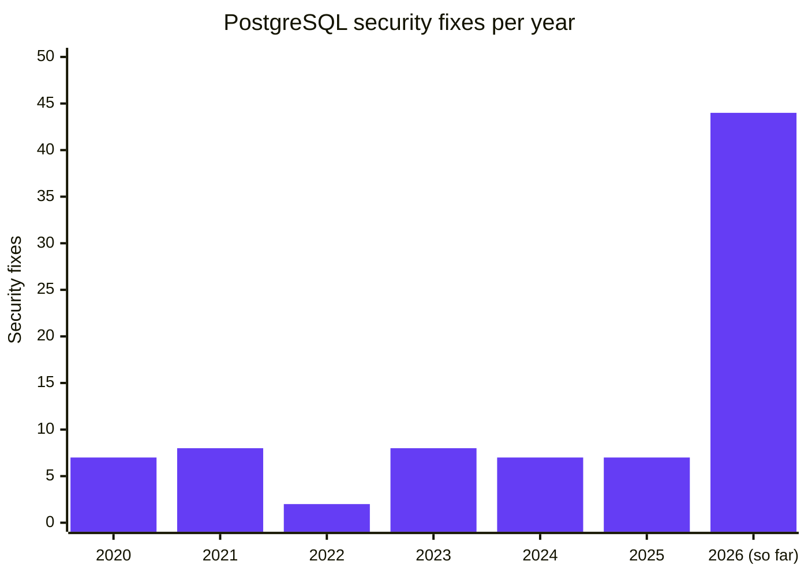

Everyone who follows database news has already heard about the delays of PostgreSQL 19:
the major release that was supposed to go GA in September, now scheduled to be released on November 19 after multiple delays.
What happened, is AI to blame, and why am I apologizing?

Outside committers, I am the only contributor "responsible" for clearly [causing a last-minute revert](https://hackorum.dev/topics/253174) of a major feature, while I also reported multiple issues about FOR PORTION OF, REPACK and online checksums. I was one of the developers trying to save the online checksums even at the last minute, when the original RC1 deadline already passed.

The primary "culprits" behind the delay are of course committers: Robert Haas, who started the mass revert discussion with the ["scary patch contest"](https://hackorum.dev/topics/253549), Noah Misch, who called for 8 reverts, and Andres Freund, who called for only 2, but one of them was PGQ.

The above is of course sarcasm, and the people above are the ones who made sure that PG19 will be as stable as possible, so please don't harass them.

# Unlucky timing in a changing world

It's quite clear from the pgsql-hackers threads that many of the reported issues were found by AI reviews.
But AI was already used before, if not for development, then for review, so what happened here?
If AI is so easy to use and run, how did everyone miss so many issues?

AI is advancing rapidly.
A year or a year and a half ago it was already capable of doing significant work on websites and in many other areas, but back then when I tried to use it for postgres development, I often hit roadblocks:
it had major issues understanding some of the "stranger" constructs PostgreSQL's C codebase uses, and it wasn't even capable of reliably working on small extensions without significant human involvement.

When I started using it to help review PostgreSQL patches at the beginning of this year, it was already somewhat better, but still far from perfect: it mostly found minor issues or false positives, even when I actively tried to prompt it into looking into trickier questions.

Several of the now reverted patches were already committed at that point, and even the others were under development for a long time.

While improvements to LLMs happened gradually over time, there were major jumps:
the introduction of Fable 5 in June, Opus 5 and GPT-5.6 in July, Opus 5.5 and GPT-6 in September.

These models all made a significant difference in the number / complexity of the issues found, and they have one thing in common: all were released after the feature freeze for PostgreSQL 19.

AI will continue to advance, so in that sense, this could be a continuing problem in later years.
On the other hand, the current models already find as many issues in a patch as humans do, or more, so the worst may be behind us.
At least we hope so.

I would say that with good prompting, the main missing thing with AI is design-level review:
answering the questions of "is this the proper way to do it", or "does this feature even make sense for PostgreSQL?"

This doesn't mean that future models won't find more logic issues, but my hope is that the effect will be less dramatic in the next years.
AI still needs proper guidance.
But with humans focusing on the above design questions, and filtering out the "noise" of minor/nitpick issues sometimes elevated to blockers by AI reviews, LLMs can significantly improve the quality of future code contributions.

Unless all senior developers burn out before we reach that, and decide to become carpenters.

# A side channel attack: the vulnpocalypse

Other than the above problems, in which LLMs played a direct role, they also had an indirect effect on the release: the [vulnpocalypse](https://en.wiktionary.org/wiki/vulnpocalypse) happened, and postgres is affected by it.

This is visible from the number of security issues fixed in recent years alone:

The picture is even worse if we check the distribution of those 44: "only" 5 fixes in February, 11 in May and 28 in August.

That 28 lines up perfectly with the beta period, where committers usually focus on making sure that the release is as good as it can be.
Previously, 1 or 2 committers typically worked on security fixes for a minor release.
In August, 10 committers did, taking significant time away from the most active participants in postgres development.

And this is only what we can see in the commit history:
I think many of us suspect that the real workload, the number of both good and bad AI-generated or AI-inspired submissions, is much higher than this.
And we don't even have to suspect it, as some committers and contributors are [openly](https://peter.eisentraut.org/blog/2026/10/09/the-reverts-will-continue-until-morale-improves) [talking](https://hackorum.dev/topics/253549) [about](https://hackorum.dev/topics/253680) [the](https://hackorum.dev/topics/253972) [problem](https://hackorum.dev/topics/253171).

It also didn't magically disappear after the August release:
as we can see from the previous dates, some of the mentioned models were released after August.
These models are already very good at reviewing patches, but reviewing entire huge codebases is still tricky, and will require both better models and better tooling.

While I can't see into the future, and I can't tell how many security issues the November releases will fix, I would bet a significant amount on the number being above 28, and on it staying higher than normal for many future minor releases.

# What can we do better?

While PostgreSQL usually moves at a slow pace, we can already see that things are happening:

[One of the threads I posted earlier](https://hackorum.dev/topics/253680) in this post is about PostgreSQL increasing its minor release schedule to every 2 or 1.5 months.
This won't help with the issue of limited resources (the same security team that previously handled 8 issues a year now has to handle possibly 100+), but it can help users receive the fixes to issues discoverable with frontier models more quickly, and can help even out the pacing for the developers working on them.

Another thread is about improving the process of [becoming a committer](https://hackorum.dev/topics/253900).
PostgreSQL having more committers could spread the load, not just with the security issues, but also with handling the increasing number of AI contributions to the project.

# Where can YOU help?

You don't have to be a developer to participate:
even if PostgreSQL gets more committers, they will still need more people interested in trying out and reviewing features.
You can try out interesting features even before they get committed to the main codebase.
Knowing which patches generate interest, and which seem to be in a good-enough state for end users, could be valuable additional feedback for patch authors, reviewers and committers.

If you like a patch, don't be afraid to simply reply "This is a great idea", that itself is feedback!
And if you don't even know how to get started with that, and only want to ask "How could I contribute?", that's also a good starting point and feedback.

This is also where our work with [hackorum.dev](https://hackorum.dev/) comes into the picture.
Hackorum makes it easier to follow the development of PostgreSQL in a nice user interface, and now it also provides automatically built Docker images for each patch submission.

You don't have to learn how to apply a patch, or build postgres, you don't even have to install a Linux VM:
just go to an interesting thread, execute the displayed docker command, and you will be immediately presented with a PostgreSQL instance containing the patch.

Are you interested in [WAL compression](https://hackorum.dev/topics/50890), [JSON-based postgres configuration files](https://hackorum.dev/topics/253013), a [WHERE clause for REFRESH MATERIALIZED VIEW](https://hackorum.dev/topics/52845), or simply quickly trying out the fix for a bug you encountered or reported before it is released? All of these are one command away, and these are just a few examples.

# Lessons for us

For me, the biggest takeaway from this release is that I should pay more attention to things already committed, and I think this is a lesson for many people.

Previously I focused on reviewing active threads, patches that were still under discussion, and simply accepted what already got to the master branch as "stable".
This was both intentional and a simple constraint, as I only have so many hours I can spend on postgres, and I have to decide where to spend them.

Fortunately this is a question where both AI and habits can help:
at Percona we already have an AI automation reviewing all new commits to PostgreSQL and a few other projects every day, and the same automation also warns if something significant was changed.
Reading at least the description/summary of what changed every day is also a good habit.

# The outlook for PG20

We have to accept what happened with PostgreSQL 19, but what does all the above mean for 20?

At first, the outlook might seem grim:
if the number of security and normal bug reports continues to rise, committers will have even less time to work on other things, and we could end up with a bugfix-only release.

On the other hand, a significant number of PostgreSQL 19 features were reverted, and these now have a good chance to make it into 20.
We can already see this intention: some features were reverted only from the REL_19_STABLE branch, but kept in master, and even those that were completely reverted have a chance of coming back.

It's easy to find people arguing for both outcomes, and I don't think anybody can give any answer other than a wild guess.

Will PG20 have *some* new features?
For sure.
But will it end up as ambitious as PG19 was originally, or even half? It's too early to tell, we have to wait and see.

And, if you have some time, of course, don't forget to help out! Every patch properly tested before commit is one less revert next August!

Stay tuned for my next apology!