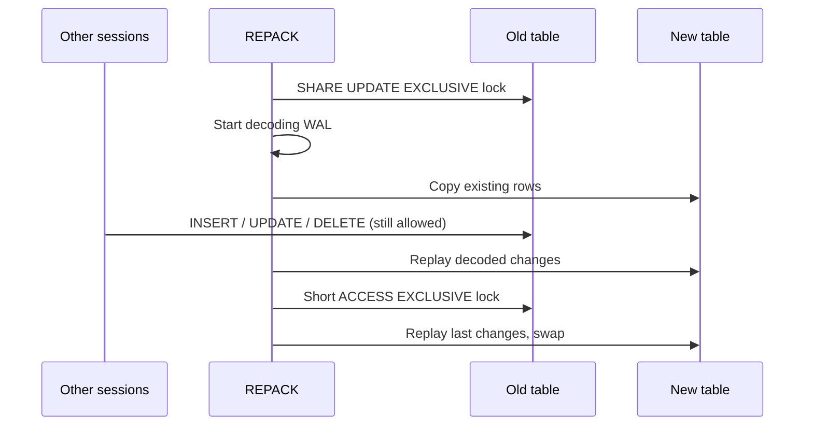
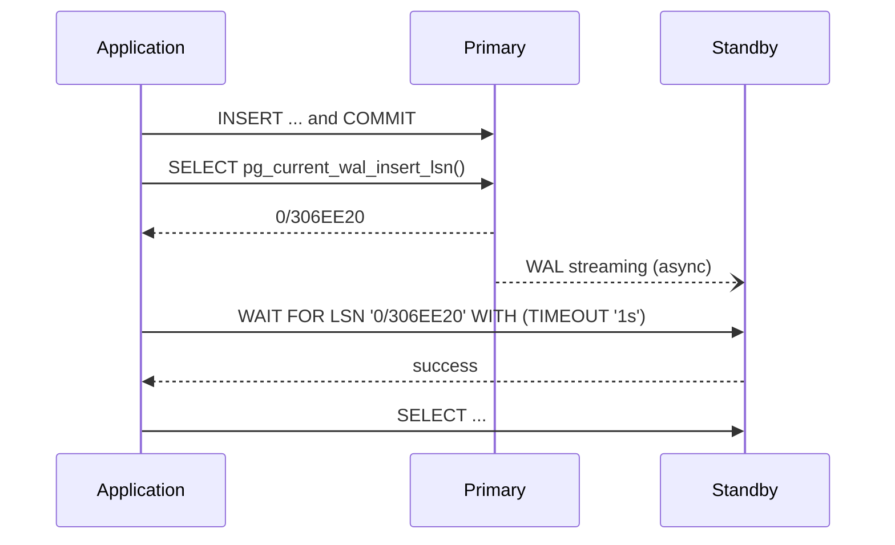

Yesterday, PostgreSQL 19 was finally released after multiple delays.
Everyone already knows about the [many reverts](https://percona.community/blog/2026/10/15/apologies-for-delaying-postgres-19/) that happened, but what actually remains? Is it still an interesting release?

This blog post doesn't aim to be a complete list:
the [release notes](https://www.postgresql.org/docs/release/19.0/) are there for that.

It is only a short highlight of some of the more interesting additions.

# We lost some interesting features

While I do not want to go into the details about the "lost features" again, the list is long.

We expected to have things like property graph queries, temporal updates and deletes (`FOR PORTION OF`), partition merging and splitting, online data checksum transitions, GROUP BY ALL... most of them ambitious additions, and all of them clearly worth a mention in the release notes.

Hopefully we will see them again in PostgreSQL 20 or later, making that also an interesting release.

Also, if we look at the above list, we can clearly see that 4 of the 5 would have been visible to any user of PostgreSQL 19, not only DBAs, the only exception being online data checksum transitions.

Let's start our feature tour in this direction:
what changes will anybody be able to notice in PostgreSQL 19?

# REPACK (CONCURRENTLY)

Previously we had `VACUUM FULL` and `CLUSTER`:
two very different sounding commands, sharing the same internal implementation.
Both rewrote the entire table, the difference was just how it was organized.

In 19, meet `REPACK`, the non-concurrent version:
instead of 2 names, now we have 3 names for the same thing!

* `REPACK mytable;` is basically `VACUUM FULL mytable;`
* `REPACK mytable USING INDEX mytable_pk;` is basically `CLUSTER mytable USING mytable_pk;`

This itself is not that interesting, other than that people no longer have to use two different and somewhat confusing names, but it doesn't stop here:
we also have `REPACK (CONCURRENTLY) mytable [USING INDEX mytable_pk];`.


The difference is in the name:
while the previous variants, even with the new `REPACK` name, take an exclusive lock and block access to the table in question, the new concurrent repack allows reads and writes to the table while it runs.
It still blocks DDL, `VACUUM` (including autovacuum) and other `REPACK` runs on the same table, as it holds a `SHARE UPDATE EXCLUSIVE` lock during the entire operation.

This itself isn't strictly new, as extensions such as [pg_repack](https://reorg.github.io/pg_repack/) (even sharing the same name) or [pg_squeeze](https://github.com/cybertec-postgresql/pg_squeeze) already did this, but until now it wasn't a core feature.

Despite the similar name, the two work somewhat differently.
The basic idea of both approaches is the same:
instead of exclusively locking the table for the entire operation, keep that lock as short as possible.
Create a new table, start capturing the changes happening to the old table, and copy the existing records.
When the copy is done, replay the captured changes, and swap the tables with a short-lived exclusive lock.

If we look into the details, `pg_repack` uses row-level triggers to implement this, while `REPACK` is based on logical decoding, like `pg_squeeze` does -- but with a simpler user interface, more like ordinary `VACUUM` or `CLUSTER`.
This makes a difference in who pays for the additional work:
with triggers, every concurrent write also has to record the change in a log table, in the writing session, while with logical decoding the changes are collected by the `REPACK` process itself, by decoding the WAL.
It also works with `wal_level = replica`, there's no need to enable logical replication first.

Putting it all together, `REPACK (CONCURRENTLY)` works like this:



On the other hand, the initial `REPACK` implementation is more limited than `pg_repack`, but it should cover the main use cases.
`REPACK (CONCURRENTLY)` requires a primary key or a replica identity index, doesn't work on partitioned or unlogged tables, materialized views or system catalogs and can't run inside a transaction block. 
And `pg_repack` also has a few features `REPACK` doesn't, such as ordering by arbitrary columns, moving the table to a different tablespace, or only rebuilding the indexes.

Only switch to using `REPACK (CONCURRENTLY)` if these limitations are acceptable to your use case.

# INSERT ... ON CONFLICT DO SELECT

PostgreSQL already supported `ON CONFLICT DO UPDATE`, which allowed an `INSERT` statement to perform an `UPDATE` instead when it wasn't possible to insert a record because of a conflict, such as a unique key violation.
The other option was `DO NOTHING`, which, as the name suggests, does nothing.

Somewhat confusingly, the syntax allows `DO NOTHING RETURNING *`, but that means "on conflict, do nothing; on success, return the row", which is not what people usually want in case of a conflict.

With 19, we can finally `SELECT` the conflicting row instead:

```sql
INSERT INTO users (email, name)
VALUES ('alice@example.com', 'Alice')
ON CONFLICT (email) DO SELECT RETURNING id;
```

This returns the user's id both when the insert succeeds and when the email already exists, as a single atomic operation.
The `RETURNING` clause is mandatory, `DO SELECT` without it is an error.

Previously, the usual workarounds were either a dummy update, such as `DO UPDATE SET email = EXCLUDED.email`, which writes a new row version, fires update triggers and creates bloat, or a CTE combining `DO NOTHING` with a separate `SELECT`, which can return no rows at all if a concurrent transaction inserts the same email.

It also supports a locking clause (such as `FOR UPDATE`) and a `WHERE` condition, similarly to `DO UPDATE`.
Locking is useful if the application already knows that it will likely modify the returned row, or if it wants to make sure that the row is not deleted by a different session.

One thing didn't change: just like with the other `ON CONFLICT` variants, a conflicting insert still consumes a sequence value.

# IGNORE NULLS

Previously, window functions such as `lag` or `last_value` treated NULLs as ordinary values.
For example, consider a table of temperature readings with values such as:

| ts    | temperature |
|-------|-------------|
| 10:00 | 21          |
| 10:01 | NULL        |
| 10:02 | NULL        |
| 10:03 | 23          |
| 10:04 | NULL        |
| 10:05 | 22          |

If you simply run:

```sql
SELECT
    ts,
    temperature,
    lag(temperature)
        OVER (ORDER BY ts) AS previous
FROM readings;
```

you'll end up with lots of NULLs, not only in the `temperature`, but also in the `previous` column.
In earlier releases, there was no easy way to fix this without complex queries.
With the new `IGNORE NULLS` we can simply write:

```sql
SELECT
    ts,
    temperature,
    lag(temperature) IGNORE NULLS
        OVER (ORDER BY ts) AS previous_known,
    last_value(temperature) IGNORE NULLS
        OVER (ORDER BY ts) AS last_known
FROM readings;
```

Which results in:

| ts    | temperature | previous_known | last_known |
|-------|-------------|----------------|------------|
| 10:00 | 21          | NULL           | 21         |
| 10:01 | NULL        | 21             | 21         |
| 10:02 | NULL        | 21             | 21         |
| 10:03 | 23          | 21             | 23         |
| 10:04 | NULL        | 23             | 23         |
| 10:05 | 22          | 23             | 22         |

`IGNORE NULLS` works with `lead`, `lag`, `first_value`, `last_value` and `nth_value`.

# WAIT FOR LSN

The new `WAIT FOR LSN` allows applications to wait until a standby has replayed a particular WAL position before executing a read.
This effectively removes the stale read problem of replication without requiring synchronous replication, for example in configurations where writes go to the primary, but reads are routed to a replica.

The application has to remember the LSN of its last write on the primary, and pass it to the standby:



In SQL:

```sql
-- on the primary, after the COMMIT
SELECT pg_current_wal_insert_lsn();

-- on the standby, before the read
WAIT FOR LSN '0/306EE20' WITH (TIMEOUT '1s');
```

Without a `TIMEOUT` it waits indefinitely, and with a timeout, it might raise an error, unless `NO_THROW` is also specified.

However, I have to point out that there is already a [known bug](https://hackorum.dev/topics/139363#message-1156134) reported by Jobin Augustine, which unfortunately wasn't fixed in 19.0:
if the LSN returned by `pg_current_wal_insert_lsn()` lands exactly on a WAL page boundary, the wait can hang until some unrelated WAL is written, or until the timeout expires.
In Jobin's testing, this happened in about 1 of 2000 waits.
The [fix](https://github.com/postgres/postgres/commit/24723e7cf397fc0f79b0b14412831db36882a29a) was committed a day before the release, after 19.0 was already stamped, so it will be part of 19.1.

Until then, I would recommend not using this feature in production, or at least always specifying a `TIMEOUT`.

# Faster query execution

There are many improvements that have no user-visible interface changes, but should result in better performance for many queries and schemas, such as:

* Faster foreign key checks, when inserting or updating rows in the referencing table
* Radix sort, used for some sorts instead of the usual comparison-based sorting
* Faster tuple deforming: extracting column values from the stored row format, which happens for almost every row a query touches
* Aggregation before joins: the planner can now partially aggregate rows before a join, reducing the number of rows the join has to process
* and many more

# Parallel autovacuum and improved scheduling

Autovacuum got multiple updates in 19, the two most important being parallel index vacuuming and priority-based scheduling.

## Parallel workers

In earlier releases, manual `VACUUM` could use parallel workers for processing indexes, but autovacuum couldn't:
it was always sequential, processing the main table and then index 1, index 2, index 3...

Now it behaves similarly to how manual `VACUUM` works: index vacuuming is parallelized across workers, based on the new `autovacuum_max_parallel_workers` setting, which limits how many parallel workers a single autovacuum worker can use, or the per-table `autovacuum_parallel_workers` limit:

```sql
-- The default is 0, so this is disabled unless you explicitly enable it
ALTER SYSTEM SET autovacuum_max_parallel_workers = 4;
SELECT pg_reload_conf();

ALTER TABLE large_events SET (
    autovacuum_parallel_workers = 2
);
```

These limits are different from `autovacuum_max_workers`, which controls how many autovacuum operations can run concurrently on different tables.

For example, with 3 autovacuum workers and 2 parallel workers each, the server can process up to 9 indexes at the same time:
the autovacuum worker itself also processes indexes, not only its parallel workers.
These parallel workers come from the same `max_parallel_workers` pool as parallel queries, and small indexes (below `min_parallel_index_scan_size`) are always processed by the autovacuum worker itself.

Vacuum cost accounting is also properly shared between parallel workers, to avoid unintentionally exceeding the I/O budget with the new system.

## Priority-based scheduling

Autovacuum always had eligibility thresholds: the number of dead tuples, inserts, and modifications since the last `ANALYZE`, and also transaction age.
But once tables became eligible, there wasn't any prioritization between them:
tables in a database were processed in the order they were found in `pg_class`, so a table close to wraparound could easily wait behind many small tables with a few dead tuples.

PostgreSQL 19 introduces a scoring system based on the same concepts, each with configurable weights:

```ini
autovacuum_freeze_score_weight = 1.0
autovacuum_multixact_freeze_score_weight = 1.0
autovacuum_vacuum_score_weight = 1.0
autovacuum_vacuum_insert_score_weight = 1.0
autovacuum_analyze_score_weight = 1.0
```

Based on these, the server can now prioritize which table to vacuum first.

There's also a new view that makes the scores easily visible to users:

```sql
SELECT relname, score, xid_score, vacuum_score, do_vacuum, for_wraparound
FROM pg_stat_autovacuum_scores
ORDER BY score DESC
LIMIT 10;
```

# Ordinary queries can now update the visibility map

This is closely related to the above, since previously only `VACUUM` and `COPY ... FREEZE` could mark a page as all-visible.

With PG19, ordinary table scans executed by simple `SELECT` statements can also mark qualifying pages as all-visible.
Consider append-heavy workloads, for example a table that mostly receives `INSERT` and `SELECT` statements:
previously, newly inserted pages weren't marked as all-visible until the next vacuum, and scans had to check tuple visibility.

Now, if a sequential scan establishes that every record in a page is visible, it can set the page's all-visible bit, so that subsequent scans can be faster.

The bigger win is probably with index-only scans:
on all-visible pages they don't have to visit the table at all, which previously required waiting for (auto)vacuum on such tables.
And the next vacuum can also skip these pages.

The scans only set the all-visible bit, not all-frozen, freezing is still the job of vacuum.

# pg_plan_advice and pg_stash_advice

These are two new modules in `contrib`.
This means that they aren't enabled by default, and an administrator has to add them to a server, but once that's done, they give users an ability previously not available in core PostgreSQL:

* `pg_plan_advice` lets users control planner decisions
* and `pg_stash_advice` can store this advice per query ID, and apply it automatically

This can be used to lock in unstable plans, and in the future we might even see automated query tuning tools relying on it.


Similarly to `pg_repack`, the [pg_hint_plan](https://github.com/ossc-db/pg_hint_plan) extension already provided something like this, but now it is part of core, and the advice can be generated directly from an existing plan.

`pg_plan_advice` is a simple loadable module, and once loaded, `EXPLAIN` can show the advice describing the current plan:

```sql
LOAD 'pg_plan_advice';
EXPLAIN (COSTS OFF, PLAN_ADVICE)
SELECT * FROM a JOIN b ON a.id = b.a_id WHERE a.x < 100;
```

```
           QUERY PLAN
---------------------------------
 Hash Join
   Hash Cond: (b.a_id = a.id)
   ->  Seq Scan on b
   ->  Hash
         ->  Seq Scan on a
               Filter: (x < 100)
 Generated Plan Advice:
   JOIN_ORDER(b a)
   HASH_JOIN(a)
   SEQ_SCAN(b a)
   NO_GATHER(a b)
```

The same format can be used to force a different plan, for example to build the hash table on `b` instead:

```sql
SET pg_plan_advice.advice = 'HASH_JOIN(b) SEQ_SCAN(b)';
```

`pg_stash_advice` is an extension, which stores these advice strings in named stashes, keyed by query ID, and applies them automatically in sessions.

# Logical replication improvements

Logical replication also received many updates, with two worth mentioning here:

Previously, to enable logical replication, administrators had to switch `wal_level` from `replica` to `logical`, which required a server restart.
Now this is no longer necessary: even when `wal_level` is set to `replica`, the server automatically switches to `logical` when a logical replication slot is created, and back to `replica` when the last one is dropped.
There's a new `effective_wal_level` setting, which shows the value actually used by the server.

Logical replication also got support for replicating sequences, but it isn't continuous like table replication:
the publication has to include them (`CREATE PUBLICATION ... FOR ALL SEQUENCES`), and the subscriber copies the current values at `CREATE SUBSCRIPTION`, and later only when explicitly asked to, with `ALTER SUBSCRIPTION ... REFRESH SEQUENCES`.
For switchover workflows this is still useful, as running the refresh right before the switch replaces the previous manual handling of sequences.
Unfortunately for major-version upgrades, it requires a PostgreSQL 19 or newer publisher, so it can only help starting with the next upgrade, from 19 to 20.

# There's more!

As I wrote at the beginning, this is just a teaser, a selection of features that I think would be interesting for most users.

For the complete list, see the [PostgreSQL 19 release notes](https://www.postgresql.org/docs/release/19.0/), which contain every change worth mentioning in the new release.

The new major version is already available both in [Percona repositories](https://docs.percona.com/postgresql/19/installing.html) and in PGDG, try it out and test the new features!
